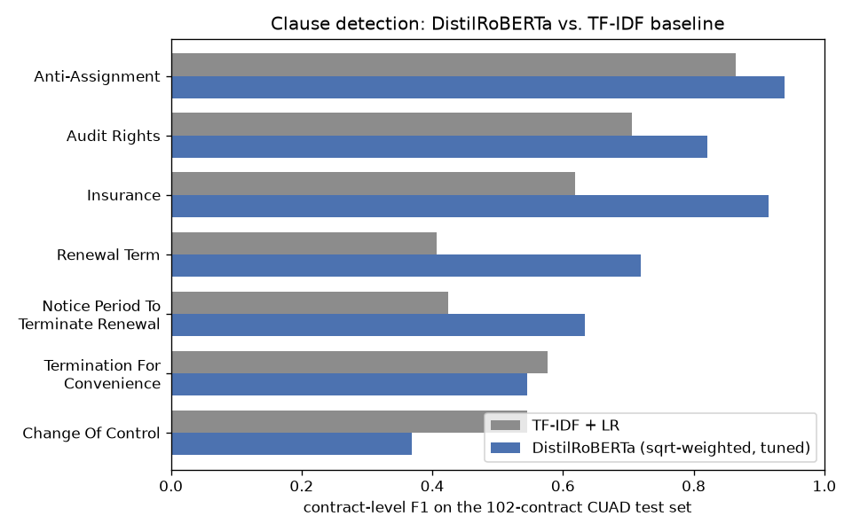
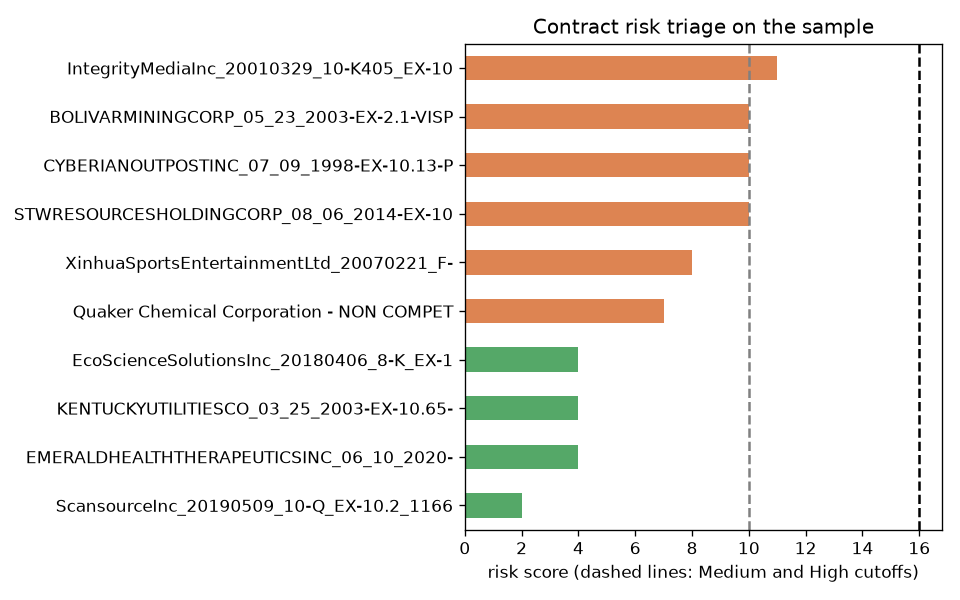

# AI-Assisted Contract Review & Risk Triage

**Break Through Tech AI Studio, Fall 2026 · Challenge project with Accenture**

An NLP pipeline that reads commercial contracts, detects 41 types of legally important clauses with a fine-tuned **DistilRoBERTa** model, and ranks contracts into **Low / Medium / High** review priority with an explainable, rule-based risk score.


[](https://colab.research.google.com/github/naeemexe/ai-contract-risk-triage/blob/main/notebooks/quickstart_demo.ipynb)

> This is my portfolio copy of the team repository [Break-Through-Tech/Accenture-1F-contract-review-challenge](https://github.com/Break-Through-Tech/Accenture-1F-contract-review-challenge). It adds a quickstart notebook, a sample dataset, and full documentation.

---

## Table of Contents

- [Project Overview](#project-overview)
- [Objectives and Goals](#objectives-and-goals)
- [Methodology](#methodology)
- [Results and Key Findings](#results-and-key-findings)
- [Visualizations](#visualizations)
- [Installation](#installation)
- [Usage: Train and Evaluate](#usage-train-and-evaluate)
- [Sample Dataset](#sample-dataset)
- [Notebooks](#notebooks)
- [Documentation](#documentation)
- [Repository Structure](#repository-structure)
- [Potential Next Steps](#potential-next-steps)
- [Individual Contributions](#individual-contributions)
- [Team](#team)
- [Limitations](#limitations)
- [Acknowledgments and License](#acknowledgments-and-license)

---

## Project Overview

Legal and procurement teams review hundreds of contracts to find clauses that create risk, such as uncapped liability, exclusivity, or change-of-control terms. Reading every contract in full is slow and expensive.

This project builds an **AI-assisted triage pipeline** that:

1. splits long contracts into model-sized chunks without losing text,
2. detects which of the 41 CUAD clause categories each contract contains,
3. scores each contract's risk with transparent rules, and
4. ranks contracts so human reviewers look at the riskiest ones first.

The system supports human reviewers. It does not give legal advice or replace legal review.

## Objectives and Goals

- **Detect clauses accurately** across 41 highly imbalanced categories, measured by per-category precision, recall, and F1.
- **Beat a classical baseline**: outperform TF-IDF + Logistic Regression on a fixed set of 7 benchmark categories.
- **Make risk explainable**: every point of a contract's risk score traces back to a named clause or rule.
- **Keep it reproducible**: official CUAD splits, fixed seeds, scripted pipeline, and documented results.

## Methodology

```text
CUAD contracts (510)
      ↓  EDA, cleaning, class-imbalance analysis
Paragraph-aware chunking (480 tokens, 64-token overlap, ~99% span coverage)
      ↓
Multi-label clause classification
      TF-IDF + Logistic Regression baseline  →  fine-tuned DistilRoBERTa
      ↓  class weighting + per-category threshold tuning
Contract-level predictions (max probability over chunks)
      ↓
Rule-based risk scoring (4 auditable signals)
      ↓
Low / Medium / High triage + clause register with evidence
```

**Data.** The [Contract Understanding Atticus Dataset (CUAD v1)](https://www.atticusprojectai.org/cuad): 510 commercial contracts, 41 expert-annotated clause categories, 13,823 annotated spans. We keep CUAD's official contract-level split (408 train / 102 test) so chunks from one contract never appear in both sets. 40 training contracts are held out for validation.

**Chunking.** Contracts average ~28 chunks each under a 512-token model limit. The paragraph-aware chunker keeps paragraphs intact where possible. A label is 1 if a clause is fully inside a chunk, 0 if absent, and masked if it only partially overlaps, so the loss ignores ambiguous cases.

**Models.**
- *Baseline:* TF-IDF (1-2 grams) + one Logistic Regression per category with balanced class weights.
- *Transformer:* `distilroberta-base` with 41 sigmoid outputs and masked binary cross-entropy. Rare classes are up-weighted by √(neg/pos), capped at 30. Decision thresholds are tuned per category on validation data.

**Risk scoring.** Clause categories carry a Low / Medium / High level from an advisor-reviewed rubric (`evaluation/risk_rubric.md`). The score combines four signals: (1) clauses present, weighted by level and confidence; (2) a severity floor for confident High-risk clauses; (3) missing protections, such as no cap on liability; (4) risky combinations, such as exclusivity plus minimum commitment. Bucket cutoffs are percentiles of the training contracts' scores.

## Results and Key Findings

| Model | Macro F1, 7 benchmark categories | Macro F1, 19 risk categories | Macro F1, all 40 evaluable | Micro F1 |
|---|---:|---:|---:|---:|
| TF-IDF + Logistic Regression | 0.592 | n/a | n/a | n/a |
| DistilRoBERTa, unweighted, threshold 0.5 | 0.084 | 0.111 | 0.164 | 0.529 |
| **DistilRoBERTa, sqrt-weighted, tuned thresholds** | **0.706** | **0.694** | **0.596** | **0.752** |

*Contract-level scores on the 102-contract CUAD test set. Full tables: [`training/results/distilroberta_baseline/RESULTS.md`](training/results/distilroberta_baseline/RESULTS.md).*

**Key findings**

- **Class weighting is essential.** Without it, the transformer predicts almost nothing for rare categories (macro F1 0.16). Square-root weighting plus tuned thresholds lifts this to 0.60.
- **The transformer beats TF-IDF on 5 of 7 benchmark categories**, with large gains on Insurance (0.92 vs 0.62), Renewal Term (0.72 vs 0.41), and Notice Period to Terminate Renewal (0.63 vs 0.42).
- **Change of Control is the main weakness** (0.37 vs 0.55 for TF-IDF). It is rated High risk, so the risk layer adds a keyword backstop rule for it.
- **Categories with 3 or fewer test contracts score 0.** More data or few-shot methods are needed for these.
- **Fixing the chunker mattered.** An early version dropped contract text when counting tokens. The fix raised annotated-span coverage to about 99%.

## Visualizations

| Class imbalance in CUAD | DistilRoBERTa vs. TF-IDF |
|---|---|
|  |  |

| Chunking: coverage vs. redundancy | Risk triage on the sample dataset |
|---|---|
|  |  |

## Installation

Requirements: Python 3.10+, Git, and about 2 GB of disk space. A GPU is optional for the quickstart and recommended for training (a free Colab T4 works).

```bash
# 1. Clone the repository
git clone https://github.com/naeemexe/ai-contract-risk-triage.git
cd ai-contract-risk-triage

# 2. Create and activate a virtual environment
python -m venv .venv
source .venv/bin/activate        # Windows: .venv\Scripts\activate

# 3. Install dependencies
pip install -r requirements.txt
```

The full CUAD data is already included in `data/cuad/`, so no download is needed.

**Check the install** by running the quickstart notebook (about 1 minute on a laptop CPU):

```bash
jupyter notebook notebooks/quickstart_demo.ipynb
```

## Usage: Train and Evaluate

Run these from the repository root.

**Step 1. Prepare the dataset.** Chunks and tokenizes every contract, checks that no text is dropped, and writes to `training/data/`.

```bash
python training/prepare_dataset.py
```

**Step 2. Train the model.** About 10 minutes per epoch on an Apple M4 Pro or a Colab T4.

```bash
# Quick smoke test (1 epoch, 64 examples)
python training/train_distilroberta.py --epochs 1 --limit 64

# Recommended model: square-root class weighting
python training/train_distilroberta.py --epochs 3 --pos-weight-mode sqrt --out training/outputs/sqrt_weighted
```

No local GPU? Open [`notebooks/naeem_distilroberta_finetune_colab.ipynb`](notebooks/naeem_distilroberta_finetune_colab.ipynb) in Colab and choose a T4 GPU runtime.

**Step 3. Evaluate.** Tunes per-category thresholds on validation data, then reports chunk- and contract-level metrics, the TF-IDF comparison, and an error analysis.

```bash
python training/evaluate.py --runs training/outputs/sqrt_weighted
```

**Step 4. Score contract risk.**

```bash
# Ceiling: score using the expert annotations
python risk/score_contracts.py --source gold

# Score using model predictions
python risk/score_contracts.py --source model --run training/outputs/sqrt_weighted
```

Outputs go to `risk/outputs/`: a ranked `contract_scores.csv`, a `clause_register.csv` with evidence text, and a `sensitivity.csv` that shows how stable the ranking is.

## Sample Dataset

[`data/sample/`](data/sample/) holds 10 contracts from the CUAD test split for quick experiments:

- `sample_contracts.json`: contracts in CUAD's SQuAD-style JSON format (works with every script that takes `--test`)
- `sample_clause_labels.csv`: one row per contract and category, with a presence flag and the first annotated span

```bash
python risk/score_contracts.py --source gold --test data/sample/sample_contracts.json --out risk/outputs/sample
```

See [`data/sample/README.md`](data/sample/README.md) for the schema.

## Notebooks

| Notebook | What it shows |
|---|---|
| [`quickstart_demo.ipynb`](notebooks/quickstart_demo.ipynb) | End-to-end demo on the sample data: explore, detect clauses with TF-IDF, score risk, explain the top result. CPU only. |
| [`naeem_distilroberta_finetune_colab.ipynb`](notebooks/naeem_distilroberta_finetune_colab.ipynb) | Fine-tune DistilRoBERTa on a Colab GPU. |
| [`naeem_tfidf_baseline_risk_rules.ipynb`](notebooks/naeem_tfidf_baseline_risk_rules.ipynb) | TF-IDF + Logistic Regression baseline and the first risk-tier rules. |
| [`CUAD_EDA.ipynb`](notebooks/CUAD_EDA.ipynb) | Exploratory data analysis: imbalance, lengths, overlap. |
| [`JSONtoDF.ipynb`](notebooks/JSONtoDF.ipynb) | Convert CUAD JSON to pandas DataFrames. |

## Documentation

- [**User Guide**](docs/USER_GUIDE.md): how to run the pipeline, read the outputs, and change the risk rules.
- [**API Reference**](docs/API.md): every script's command-line options and the main Python functions.
- [Training pipeline details](training/README.md) · [Risk scoring rules](risk/README.md) · [Risk rubric](evaluation/risk_rubric.md) · [Chunking study](Week%203/WEEK3_README_DETAILED.md) · [Challenge overview](Challenge-Project-Overview.md)

## Repository Structure

```text
.
├── data/
│   ├── cuad/              full CUAD v1 dataset (official train/test JSON)
│   └── sample/            10-contract sample for quick tests
├── docs/                  user guide, API reference, figures
├── notebooks/             quickstart, EDA, baseline, Colab training
├── training/              dataset prep, DistilRoBERTa training, evaluation, results
├── risk/                  rule-based risk scoring and its rules file
├── evaluation/            risk rubric and category levels
├── tests/                 unit tests for the risk scorer
├── Week 2/, Week 3/       cleaning, imbalance, and chunking experiments
└── requirements.txt
```

## Potential Next Steps

- **Fix the weakest High-risk category.** Improve Change of Control recall with data augmentation or a dedicated classifier.
- **More robust thresholds.** Use cross-validation instead of 40 validation contracts.
- **Calibrate risk cutoffs** for model confidences. The model currently under-ranks Medium contracts.
- **Validate with experts.** Compare rankings against advisor-reviewed examples using rank and bucket agreement.
- **Try longer-context models** (Longformer, legal-domain BERT) to reduce chunking errors.
- **Ship a demo.** Wrap the pipeline in a simple web app where a reviewer uploads a contract and sees highlighted clauses and the risk explanation.

## Individual Contributions

**Md Naeem Islam ([@naeemexe](https://github.com/naeemexe))**

- Built the **TF-IDF + Logistic Regression baseline** on CUAD's official train/test split. It became the benchmark every later model is compared against.
- Drafted the **initial risk-tier rules** that map clause categories to Low / Medium / High risk.
- Implemented the **DistilRoBERTa multi-label fine-tuning pipeline**: `training/prepare_dataset.py` (chunking, tokenizing, label masking, coverage checks), `training/train_distilroberta.py` (masked BCE, class weighting, mixed precision, best-epoch selection), and the Colab training notebook.
- For this portfolio version: wrote the quickstart notebook, built the sample dataset, and wrote the user guide and API reference.

## Team

| Name | GitHub | Main contribution |
|---|---|---|
| Md Naeem Islam | [@naeemexe](https://github.com/naeemexe) | TF-IDF baseline, DistilRoBERTa training pipeline |
| Barry | [@barryz-cmu](https://github.com/barryz-cmu) | Cleaning, chunking, chunker fix, model training and evaluation |
| Jasmin Chan | [@tsunderii](https://github.com/tsunderii) | EDA, risk rubric, risk error analysis, documentation |
| Tobias Lin | [@TobiasLin6](https://github.com/TobiasLin6) | JSON-to-DataFrame conversion, rule-based risk-scoring layer |
| Parth Dali | [@parthd06](https://github.com/parthd06) | Project overview, data files, team coordination |

Challenge advisor: Accenture · Program: [Break Through Tech AI](https://www.breakthroughtech.org/)

## Limitations

- CUAD annotates clauses but has no validated Low / Medium / High risk labels, so risk levels come from a rubric, not ground truth.
- Categories are highly imbalanced, and some have very few examples.
- Real risk depends on context and on which party you represent.
- The system is for triage. Consequential legal or business decisions need human review.

## Acknowledgments and License

Data: CUAD v1 by The Atticus Project, licensed under [CC BY 4.0](https://creativecommons.org/licenses/by/4.0/). Thanks to Break Through Tech AI and Accenture for the challenge and mentorship.
